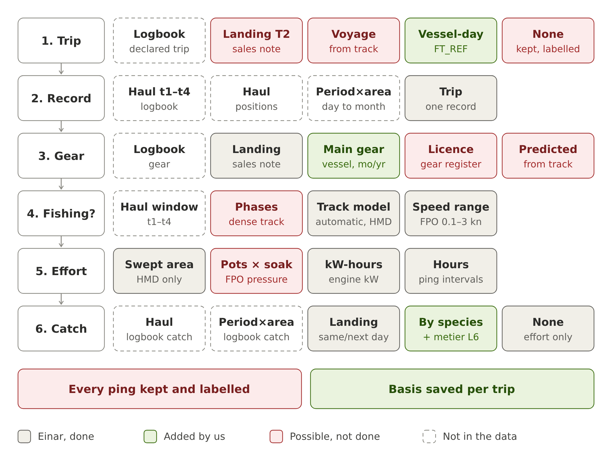

<!-- Knit from the project root (ICES_datacall/), next to 0_global.R.
     Version 1 of this report (merged .fst source) is kept as d_CajasVerdes_report_v1.Rmd -->

```{r setup, echo = FALSE}
knitr::opts_chunk$set(echo = FALSE, message = FALSE, warning = FALSE,
                      comment = NA, fig.pos = "H", out.width = "75%",
                      fig.align = "center",
                      dev = "png", dpi = 200,          # raster figures: much faster LaTeX than vector maps
                      cache.path = "Results/report_cache/")
# Heavy chunks are cached; the cache is invalidated when any input file changes
inputFiles <- c(list.files("Data", pattern = "^(tacsat|eflalo)_20[0-9]{2}\\.RData$|^cv_nv_", full.names = TRUE),
                list.files("Results", pattern = "^(tacsatActivity|tacsatEflalo).*RData$|Save\\.rds$|^speedarr_|^fishing_speeds", full.names = TRUE),
                list.files("Results_v1_fst", pattern = "^tacsatEflalo.*RData$|Save\\.rds$", full.names = TRUE))
inputStamp <- paste(file.mtime(inputFiles), collapse = ";")

# Packages and options are set here (not cached) so they apply on every knit
library(knitr)
library(data.table)
library(ggplot2)
theme_set(theme_bw(base_size = 9) +
            theme(strip.background = element_rect(fill = "grey90"),
                  legend.position = "bottom"))
options(digits = 4)
```

```{r setup2, cache = TRUE, cache.extra = inputStamp}
gearCols <- c(FPO = "#1b7837", HMD = "#d95f02")

# Coastline for maps (maps package; drawn only if available)
coast <- if (requireNamespace("maps", quietly = TRUE))
  as.data.table(ggplot2::map_data("world", xlim = c(-9, -4), ylim = c(35, 38.5))) else NULL
base_map <- function(xlim = c(-7.8, -5.0), ylim = c(35.8, 37.4)) {
  g <- ggplot()
  if (!is.null(coast))
    g <- g + geom_polygon(data = coast, aes(long, lat, group = group),
                          fill = "grey80", colour = "grey50", linewidth = 0.2)
  g + geom_vline(xintercept = -5.6, linetype = 2, colour = "grey30") +
    coord_quickmap(xlim = xlim, ylim = ylim, expand = FALSE) +
    labs(x = "Longitude", y = "Latitude") +
    guides(fill = guide_colourbar(barwidth = 14, barheight = 0.6))
}


# Paths (relative to the project root)
dataPath <- "Data/"
outPath  <- "Results/"
v1Path   <- "Results_v1_fst/"      # outputs of version 1 (merged .fst source)
years    <- 2023:2024

# Fishing speed range used in step 2 (must match 2_eflalo_tacsat_analysis.R, section 2.3)
# Read from Results/speedarr_YYYY.csv (written by step 2); fallback = values set in 2_..., section 2.3
speedFile <- list.files("Results", pattern = "^speedarr_[0-9]{4}\\.csv$", full.names = TRUE)
speedFix <- if (length(speedFile)) {
  unique(rbindlist(lapply(speedFile, fread))[, .(Gear = sub("_.*$", "", LE_L5MET), min, max)])
} else data.table(Gear = "FPO", min = 0.1, max = 3)
speedTxt <- paste(speedFix[, paste0(Gear, " ", min, "-", max, " kn")], collapse = ", ")
# Range classified as fishing by the automatic detection (HMD), written by step 2
speedAuto <- local({
  f <- paste0(outPath, "fishing_speeds_by_metier_and_year.txt")
  if (!file.exists(f)) return(data.table())
  l <- readLines(f)
  yrs <- sub("Year: ", "", grep("^Year", l, value = TRUE))
  sp  <- grep("^\"", l, value = TRUE)
  unique(rbindlist(lapply(seq_along(sp), function(i) {
    p <- strsplit(sp[i], "\t")[[1]]
    data.table(Year = trimws(yrs[i]), Metier = gsub("\"", "", p[1]),
               min = round(as.numeric(p[2]), 2), max = round(as.numeric(p[3]), 2))
  })))
})

# Helpers
load_obj <- function(f) {
  if (!file.exists(f)) return(NULL)
  e <- new.env(); load(f, envir = e); get(ls(e)[1], envir = e)
}
fmt <- function(x) format(x, big.mark = ",", scientific = FALSE)
clean_txt <- function(x) {
  x <- as.character(x)
  y <- iconv(x, from = "UTF-8", to = "latin1")          # undo double UTF-8 encoding
  ok <- !is.na(y) & validUTF8(y) & grepl("[^ -~]", x)
  Encoding(y) <- "UTF-8"
  x[ok] <- y[ok]
  x <- iconv(x, from = "UTF-8", to = "ASCII//TRANSLIT", sub = "")
  gsub("[[:cntrl:]]", "", x)
}
pct <- function(x, n) round(100 * x / n, 1)
intv_h <- function(x) if (median(x, na.rm = TRUE) > 1) x / 60 else x   # INTV: minutes until step 2.5

# ---- Inputs to the workflow (written by 0b_cajasverdes_notas_formato.R) ----
efl <- rbindlist(lapply(years, function(y) {
  x <- load_obj(paste0(dataPath, "eflalo_", y, ".RData"))
  if (is.null(x)) NULL else data.table(Year = y, x)
}), fill = TRUE)
kgCols  <- grep("^LE_KG_",   names(efl), value = TRUE)
eurCols <- grep("^LE_EURO_", names(efl), value = TRUE)
if (nrow(efl)) {
  efl[, has_note := rowSums(!is.na(.SD)) > 0, .SDcols = kgCols]
  efl[, KG  := rowSums(.SD, na.rm = TRUE), .SDcols = kgCols]
  efl[, EUR := rowSums(.SD, na.rm = TRUE), .SDcols = eurCols]
}
tac <- rbindlist(lapply(years, function(y) {
  x <- load_obj(paste0(dataPath, "tacsat_", y, ".RData"))
  if (is.null(x)) NULL else data.table(Year = y, x)[, .(Year, SI_LATI, SI_LONG)]
}))
# Trip table with the basis of every derived value
vj <- rbindlist(lapply(years, function(y) {
  f <- paste0(dataPath, "cv_nv_viajes_", y, ".csv")
  if (file.exists(f)) data.table(Year = y, fread(f)) else NULL
}), fill = TRUE)
# Sales notes of FPO/HMD that found no trip
sinT <- rbindlist(lapply(years, function(y) {
  f <- paste0(dataPath, "cv_nv_notas_sin_track_", y, ".csv")
  if (file.exists(f)) data.table(Year = y, fread(f)) else NULL
}), fill = TRUE)
res <- if (file.exists(paste0(dataPath, "cv_nv_resumen.csv"))) fread(paste0(dataPath, "cv_nv_resumen.csv")) else NULL

# ---- Workflow outputs ----
act <- rbindlist(lapply(years, function(y) {
  x <- load_obj(paste0(outPath, "tacsatActivity", y, ".RData"))
  if (is.null(x)) NULL else data.table(Year = y, as.data.table(x)[, .(LE_GEAR, SI_SP, SI_STATE)])
}))
# Summaries used by the figures and tables (the 2.5 M pings are not kept)
if (nrow(act)) {
  act[, State := ifelse(SI_STATE %in% c("f", "1", 1), "f", "s")]
  actH <- act[SI_SP <= 15, .N, by = .(Year, LE_GEAR, State, bin = floor(SI_SP / 0.25) * 0.25)]
  actS <- act[, .(Pings = fmt(.N), `Fishing (%)` = round(100 * mean(State == "f"), 1),
                  `Median fishing speed (kn)` = round(median(SI_SP[State == "f"]), 2)),
              by = .(Year, Gear = LE_GEAR)][order(Year, Gear)]
} else { actH <- actS <- data.table() }
rm(act); invisible(gc())
read_tef <- function(path) rbindlist(lapply(years, function(y) {
  x <- load_obj(paste0(path, "tacsatEflalo", y, ".RData"))
  if (is.null(x)) return(NULL)
  x <- as.data.table(x)[, .(VE_REF, SI_DATE, LE_GEAR, SI_SP, SI_LATI, SI_LONG, INTV, LE_KG_TOT, LE_EURO_TOT)]
  x[, INTV_h := intv_h(INTV)]
  data.table(Year = y, x)
}))
tef    <- read_tef(outPath)
tef_v1 <- if (dir.exists(v1Path)) read_tef(v1Path) else data.table()
t1 <- if (file.exists(paste0(outPath, "table1Save.rds"))) as.data.table(readRDS(paste0(outPath, "table1Save.rds"))) else NULL
t2 <- if (file.exists(paste0(outPath, "table2Save.rds"))) as.data.table(readRDS(paste0(outPath, "table2Save.rds"))) else NULL
t1_v1 <- if (file.exists(paste0(v1Path, "table1Save.rds"))) as.data.table(readRDS(paste0(v1Path, "table1Save.rds"))) else NULL
```

# Purpose and scope

This document records how the Andalusian small-scale fleet tracking data
("cajas verdes") and first-sale notes were prepared for the ICES VMS and
Logbook Data Call R workflow (ICES-VMS-and-Logbook-Data-Call, version 2.1.0,
commit `a844911`). It describes (i) the two source datasets, (ii) the logic used
to combine them, step by step, choosing for each variable the best source
available, (iii) how they were transformed into the TACSAT and EFLALO exchange
formats (Annex 3 of the data call), (iv) the assumptions needed to fit them into
a workflow designed for logbook/VMS data from larger vessels, and (v) every
change made to the ICES base scripts and why.

**Scope of this run**

* Fleets: traps and pots (**FPO**: *nasas* and *trampas*) and hydraulic
  dredges (**HMD**: *dragas mecanizadas hidráulicas*).
* Years: **2023 and 2024**.
* Area: ICES Division **27.9.a** (Gulf of Cádiz). Mediterranean activity is
  excluded (Section 5).

**Version 2.** A first version of this run used a file in which both sources had
already been merged (`CV_NV_2018_2024_ZE.fst`). In that file the catch was a
single total per trip and the gear had been attached before the data reached
us, so every trip followed the same fixed path through the workflow and species
were lost. This version reads the two sources separately
(`0b_cajasverdes_notas_formato.R`), keeps the catch by species and records,
for every trip, which source gave each value. Outputs of version 1 are kept in
`Results_v1_fst/` and `Data/respaldo_v1_fst/`, and compared with version 2
where relevant.

# Nature of the source data

## Cajas verdes (green boxes)

The "cajas verdes" are positioning devices installed on Andalusian small-scale
vessels that are not covered by the EU VMS obligation (most are < 12 m). They
work like a high-frequency VMS. The file used is `Data/CV_2017_2024_ZE_fmt.rds`
(`r if (!is.null(res)) paste(fmt(sum(res$pings_anio)), "pings in", paste(years, collapse = "-"), "from", max(res$buques_cv), "vessels") else "70.5 million pings, 2017-2024"`).

* Positions are reported roughly **every 3 minutes** (median interval
  `r if (!is.null(res)) paste(res$intervalo_mediana_s, collapse = " / ") else "190"` s
  in `r paste(years, collapse = " / ")`), much more often than standard VMS
  (1–2 h).
* Each record includes vessel (CFR), time, position, instantaneous speed and
  heading, plus derived fields (speed and course from consecutive positions,
  distance, time difference and an in-port flag, `EN_PUERTO`).
* The trip identifier `FT_REF` is **vessel + calendar day** (local time).
* Time stamps are in **local time (Europe/Madrid)**.
* **There is no gear**: `LE_MET4`, `LE_MET6` and the fishing-status fields are
  empty in every row. The gear must come from another source.
* The file covers **all** vessels carrying a box, whatever their gear.

## Sales notes (notas de venta)

Landings come from first-sale notes, not from logbooks. Small-scale vessels
under 10 m are not required to keep an EU logbook, so the sales note is the only
record of the catch. One file per year (`Data/notas de venta/`), covering the
whole Andalusian fleet.

* One row per **vessel x sale date x species (FAO code) x gear**, with weight
  (kg) and value (EUR).
* The gear is declared by the buyer as a text (e.g. *NASAS*, *TRAMPAS*,
  *DRAGAS MECANIZADAS (HIDRÁULICAS...)*).
* There is **no note number, no port and no time**: a note can only be linked
  to a trip by vessel and date.

```{r source-fields}
src <- data.table(
  Source = c(rep("Cajas verdes (.rds)", 7), rep("Sales notes (.xlsx)", 6)),
  Field  = c("VE_REF", "FT_REF", "SI_TIMESTAMP", "SI_LATI / SI_LONG", "SI_SP / SI_HE",
             "SI_TDIFF / EN_PUERTO", "LE_MET4 / LE_MET6",
             "ID_UDPROD", "FECHAVENTA", "FAO / NOMBRE_ESPECIE", "ARTE",
             "TOTAL_KILOS", "TOTAL_EUROS"),
  Content = c("Vessel CFR code (ESP + 9 digits)",
              "Trip = vessel + calendar day (local time)",
              "Ping time, local time (Europe/Madrid)",
              "Position, decimal degrees",
              "Speed (knots) and heading (degrees)",
              "Seconds since previous ping; 1 = ping inside a port polygon",
              "Empty in every row",
              "Vessel CFR code", "Sale date", "Species", "Gear, free text",
              "Weight sold (kg)", "Value (EUR)"))
kable(src, booktabs = TRUE, caption = "Fields of the two source datasets.")
```

# Two sources are combined


The combination follows the logic of *One flow for effort, pressure and catch
at any data resolution* (E. Hjörleifsson, working document, October 2026), which
reads the data call as six steps applied to every ping:

1. find its **trip**;
2. find the **logbook record** that covers it, if any;
3. find its **gear**;
4. decide whether the vessel was **fishing**;
5. give fishing pings their **effort** (hours, kW-hours) and a gear-specific
   **pressure**;
6. where landings exist, give them a share of **catch and value**.

Each step takes the best source it has and falls back to the next one when that
is missing, and records which source answered (its *basis*). Effort and pressure
need only pings, the vessel register and the gear; only catch and value need a
logbook or landings.

In that scheme these data sit in the row **"pings + landings"**: there is no
logbook, so step 2 has a single option (one record per trip), fishing has to
be read from the track, and the catch comes from sales notes allocated to the
trip. The ICES workflow itself follows one fixed path (daily logbook + VMS) with
no fallback and no basis. For that reason, the source hierarchy for trip, gear
and catch is applied **before** the workflow, in
`0b_cajasverdes_notas_formato.R`, and the basis of every trip is written to
`Data/cv_nv_viajes_YYYY.csv`. Steps 4 to 6 are then done by the ICES workflow.

```{r flow-data}
nTr <- if (nrow(vj)) nrow(vj) else NA
sh  <- function(v, k) if (nrow(vj)) pct(sum(vj[[v]] %in% k), nTr) else NA_real_
```

```{r fig-flow, fig.cap = "The six steps of the flow (rows) and their sources, best on the left, as described by Hjörleifsson (2026), applied to cajas verdes and sales notes. Grey: sources of the flow used here. Green: sources or outputs added in this work. Red: possible with these data but not done. White, dashed: not present in the data.", out.width = "100%"}

```

Compared with the flow, the green boxes are what this work adds: the trip is
the vessel-day of the tracking data; the vessel's main gear in its sales notes
plays the role of a licence; the catch is kept by species and gives the metier
level 6; and the basis of every value is saved per trip. The red boxes are
possible with these data and are the natural next steps: trips rebuilt from
harbour to harbour, gear predicted from the track, fishing phases from the
~3-min track, a pressure metric for pots, and keeping every ping with its
labels instead of filtering them.

## The rules applied, step by step

```{r rules}
rules <- data.table(
  Step = c("1. Trip", "2. Logbook record", "3. Gear", "4. Fishing?", "5. Effort, pressure",
           "6. Catch and value", "Metier level 6"),
  `Rule (best -> fallback)` = c(
    "Vessel + calendar day (FT_REF). Days with no ping at sea are not trips.",
    "One record per trip (LE_ID = FT_REF_1).",
    "Gear of the sales notes linked to the trip (most kg) -> main gear (most kg) of the vessel in its notes of the month -> of the year -> none (trip dropped).",
    paste0("HMD: automatic detection from the speed profile (ICES default). FPO, a passive gear outside the automatic list: fixed speed range, ", speedTxt, " (ICES workflow, step 2)."),
    "Hours from ping intervals; kW-hours with engine power from the EU Fleet Register; swept area from the BENTHIS gear-width model (HMD only).",
    "Sales notes of the same day -> of the next day, if the vessel has no trip that day -> none: the trip keeps its effort, catch NA (0 in the Annex tables).",
    "Species group with most kg in the notes of the trip (CEP, MOL, CRU, DEF) -> default of the gear (FPO_CEP, HMD_MOL)."),
  `Basis column` = c("trip_basis", "-", "gear_basis", "-", "-", "catch_basis", "metier_basis"),
  `Done in` = c("0b", "0b", "0b", "Step 2", "Step 2", "0b + step 2", "0b"))
k <- kable(rules, booktabs = TRUE, longtable = TRUE,
           caption = "Source hierarchy used for each step. 0b = 0b\\_cajasverdes\\_notas\\_formato.R.")
if (requireNamespace("kableExtra", quietly = TRUE))
  k <- kableExtra::column_spec(kableExtra::column_spec(k, 2, width = "8.5cm"), 1, width = "2.6cm")
k
```

A sales note is first matched to a trip of the same vessel on the same day. If
the vessel has no trip that day, the note goes to its trip of the previous day
(sales the morning after a night trip). Each note is used once, so the catch
total is kept. Notes that find no trip are reported in Section 4.6.

## Basis of each trip

```{r basis-table}
if (nrow(vj)) {
  b <- rbindlist(list(
    vj[, .N, by = .(Year, Gear = LE_GEAR, Basis = gear_basis)][, Step := "3. Gear"],
    vj[, .N, by = .(Year, Gear = LE_GEAR, Basis = catch_basis)][, Step := "6. Catch"],
    vj[, .N, by = .(Year, Gear = LE_GEAR, Basis = metier_basis)][, Step := "Metier L6"]))
  b[, Pct := pct(N, sum(N)), by = .(Year, Gear, Step)]
  bw <- dcast(b, Step + Basis ~ Year + Gear, value.var = "N", fill = 0)
  kable(bw, booktabs = TRUE, format.args = list(big.mark = ","),
        caption = "Number of trips by the source (basis) used for gear, catch and metier, by year and gear.")
}
```

```{r fig-basis, fig.cap = "Share of trips by basis for gear, catch and metier level 6, by gear and year.", fig.height = 3.4, out.width = "95%"}
if (nrow(vj)) {
  b[, Basis := factor(Basis, levels = c("landing", "landing_same_day", "landing_same_and_next_day",
                                        "landing_next_day", "landing_species", "dominant_month",
                                        "dominant_year", "gear_default", "none"))]
  ggplot(b, aes(paste(Gear, Year), Pct, fill = Basis)) +
    geom_col(width = 0.7) +
    facet_wrap(~ Step) +
    scale_fill_brewer(palette = "Spectral", direction = -1, name = NULL) +
    labs(x = NULL, y = "% of trips") +
    theme(axis.text.x = element_text(angle = 30, hjust = 1)) +
    guides(fill = guide_legend(nrow = 2))
}
```

**Reading the bases.** Most trips take their gear and catch from a sales note
of the same day. Trips whose gear comes only from the vessel's main gear in the
year are the weakest: they have fewer pings at sea than trips with a note and
may include days that were not fishing trips or were made with another gear.
Trips with catch basis "none" keep their effort, but add no landings.

# Transformation to TACSAT and EFLALO

The conversion is done by `0b_cajasverdes_notas_formato.R`, which runs
**before** `0_global.R`. It writes `Data/tacsat_YYYY.RData` and
`Data/eflalo_YYYY.RData`, with object names `tacsat_YYYY` and `eflalo_YYYY`, as
`1_eflalo_tacsat_preprocessing.R` expects. Version 1 of these files is kept in
`Data/respaldo_v1_fst/`.

## Comparison with the data call formats

Tables 4 and 5 compare each field required by the data call (Annex 3, TACSAT2
and EFLALO2 formats) with what cajas verdes and sales notes provide. **Status**
is one of: *Direct* (field exists and is copied), *Converted* (changes unit, time
zone or format), *Derived* (computed from other fields), *Assumed* (filled by an
assumption, Section 5), *Missing* (not available; left NA).

```{r cmp-tacsat}
cmpT <- data.table(
  Field    = c("VE_REF", "VE_COU", "SI_LATI", "SI_LONG", "SI_DATE", "SI_TIME", "SI_SP", "SI_HE"),
  `Data call format` = c("Vessel ID, 20 char", "ISO 3166-1 alpha-3", "Decimal degrees",
                         "Decimal degrees", "DD/MM/YYYY", "HH:MM, UTC", "Knots", "Degrees"),
  `Cajas verdes` = c("VE_REF (CFR)", "not present", "SI_LATI", "SI_LONG",
                     "SI_TIMESTAMP (POSIXct)", "SI_TIMESTAMP, Europe/Madrid, seconds",
                     "SI_SP (knots)", "SI_HE (degrees)"),
  Status = c("Direct", "Assumed (ESP)", "Direct", "Direct", "Converted",
             "Converted (UTC, minute)", "Direct", "Direct"))
kable(cmpT, booktabs = TRUE,
      caption = "TACSAT2 format required by the data call vs. cajas verdes positions.")
```

```{r cmp-eflalo}
cmpE <- data.table(
  Field = c("VE_REF", "VE_FLT", "VE_COU", "VE_LEN / VE_KW / VE_TON",
            "FT_REF", "FT_DCOU / FT_LCOU", "FT_DHAR / FT_LHAR",
            "FT_DDAT / FT_DTIME", "FT_LDAT / FT_LTIME",
            "LE_ID", "LE_CDAT", "LE_STIME / LE_ETIME", "LE_SLAT ... LE_ELON",
            "LE_GEAR", "LE_MSZ", "LE_RECT", "LE_DIV", "LE_MET",
            "LE_KG_[FAO code]", "LE_EURO_[FAO code]"),
  `Data call format` = c("Vessel ID", "DCF fleet", "ISO alpha-3", "LOA (m), kW, GT",
                         "Trip ID", "ISO alpha-3", "UN LOCODE",
                         "Departure DD/MM/YYYY, HH:MM", "Arrival DD/MM/YYYY, HH:MM",
                         "Log event ID", "Catch date", "HH:MM (optional)",
                         "Haul positions (optional)",
                         "Metier L4 (3 char)", "Mesh (mm)", "ICES rectangle", "ICES division",
                         "Metier L6", "kg by FAO species", "EUR by FAO species"),
  Source = c("CV: VE_REF (CFR)", "= LE_GEAR", "not present",
             "EU Fleet Register by CFR",
             "CV: FT_REF (vessel + day)", "not present", "not present",
             "CV: first ping of the day", "CV: last ping of the day",
             "not present", "CV: day of the trip", "not present", "not present",
             "SN: ARTE of the trip's notes -> vessel's main gear", "not present",
             "CV: ping positions", "CV: ping positions",
             "SN: main species group", "SN: kg by species", "SN: EUR by species"),
  Status = c("Direct", "Derived", "Assumed (ESP)", "Derived (latest record)",
             "Direct", "Assumed (ESP)", "Missing (NA)",
             "Derived (UTC)", "Derived (UTC)",
             "Derived (FT_REF_1)", "Derived", "Missing (optional)", "Missing (optional)",
             "Derived (hierarchy)", "Missing (NA)", "Derived", "Derived", "Derived (hierarchy)",
             "Direct (minor species -> MZZ)", "Direct (minor species -> MZZ)"))
kable(cmpE, booktabs = TRUE, longtable = TRUE,
      caption = "EFLALO2 format required by the data call vs. cajas verdes (CV) and sales notes (SN).")
```

```{r cmp-annex}
cmpA <- data.table(
  `Annex field` = c("VesselLengthRange", "AverageVesselLength / AveragekW",
                    "kWFishingHour (VE) / kWFishingDays (LE)",
                    "FishingHour (VE)", "FishingDays (LE)", "AverageFishingSpeed",
                    "AverageInterval", "Csquare / ICESrectangle",
                    "MetierL4 / L5 / L6", "TotWeight / TotValue",
                    "AverageGearWidth / SweptArea", "Habitat / Depth",
                    "VMSEnabled", "AnonymizedVesselID / NoDistinctVessels"),
  Required = c("Yes", "Yes", "Yes (VE) / No (LE)", "Yes", "Yes", "Yes", "Yes", "Yes",
               "Yes", "Yes / No", "Yes / No", "No", "No", "Yes"),
  `Filled from` = c("EU Fleet Register", "EU Fleet Register", "EU Fleet Register",
                    "3-min pings", "vessel-days", "pings", "pings (~3 min)", "pings",
                    "sales notes (gear, main species)", "sales notes by species",
                    "HMD: BENTHIS model; FPO: not applicable",
                    "workflow layers", "workflow", "workflow"))
kable(cmpA, booktabs = TRUE,
      caption = "Coverage of the Annex 1 (VE) and Annex 2 (LE) submission fields with these data.")
```

**Summary.** Positions are complete and of higher resolution than standard VMS.
With the sales notes read by species, the catch can be reported by FAO code and
the metier level 6 follows the main species of each trip. The remaining gaps
are haul-level information (times, positions), mesh size and ports, none of
which blocks a required Annex field.

## TACSAT (positions)

* One row per ping, restricted to the trips kept in EFLALO.
* Time converted to **UTC**, truncated to the minute (`SI_DATE` = dd/mm/yyyy,
  `SI_TIME` = HH:MM). When two pings of one vessel fall in the same minute, only
  the first is kept; otherwise `intervalTacsat()` would produce zero-length
  intervals.
* `VE_COU` = ESP. `SI_SP` and `SI_HE` are taken directly from the device.

## EFLALO (trips and landings)

One row per trip (`FT_REF`):

```{r eflalo-map}
map <- data.table(
  `EFLALO field` = c("VE_REF", "VE_FLT, LE_GEAR", "VE_COU, FT_DCOU, FT_LCOU",
                     "FT_DDAT / FT_DTIME", "FT_LDAT / FT_LTIME",
                     "FT_DHAR, FT_LHAR", "LE_ID", "LE_CDAT", "LE_MET",
                     "LE_RECT", "LE_DIV", "LE_MSZ", "LE_KG_* / LE_EURO_*",
                     "VE_LEN, VE_KW, VE_TON"),
  Source = c("VE_REF (CFR)", "Gear hierarchy (Section 3)", "\"ESP\"",
             "First ping of the trip (UTC)", "Last ping of the trip (UTC)",
             "NA (not available)", "FT_REF + \"_1\" (one log event per trip)",
             "Day of the trip (version 1: sale date)",
             "Main species group of the notes; FPO_CEP / HMD_MOL by default",
             "Most frequent ICES rectangle of the at-sea pings in 27.9.a",
             "27.9.a, or 37.1.1 if most at-sea pings have longitude > -5.6",
             "NA (passive gear / dredge)",
             "Sales notes linked to the trip, by species; NA if no note",
             "EU Fleet Register by CFR (latest record)"))
kable(map, booktabs = TRUE, caption = "Origin of each EFLALO field.")
```

## Records retained

```{r resumen}
if (!is.null(res)) {
  r <- res[, .(Year = anio,
               `Vessel-days at sea` = fmt(viajes_buque_dia),
               `FPO/HMD trips in 27.9.a` = fmt(viajes_sel),
               FPO = fmt(viajes_FPO), HMD = fmt(viajes_HMD),
               `Excluded (Mediterranean)` = fmt(viajes_mediterraneo_excluidos),
               Vessels = buques,
               `Landings linked (t)` = fmt(round(kg_asignado / 1000, 1)),
               `TACSAT pings` = fmt(pings_tacsat))]
  kable(r, booktabs = TRUE, align = "r",
        caption = "Records produced by 0b\\_cajasverdes\\_notas\\_formato.R.")
}
```

```{r v1v2-input}
v1res <- if (file.exists(paste0(dataPath, "respaldo_v1_fst/cajasverdes_resumen_formato.csv")))
  fread(paste0(dataPath, "respaldo_v1_fst/cajasverdes_resumen_formato.csv")) else NULL
if (!is.null(res) && !is.null(v1res)) {
  cmp <- merge(v1res[, .(Year = anio, v1_FPO = viajes_FPO, v1_HMD = viajes_HMD,
                         v1_t = round(kg_total / 1000, 1), v1_pings = pings_tacsat)],
               res[, .(Year = anio, v2_FPO = viajes_FPO, v2_HMD = viajes_HMD,
                       v2_t = round(kg_asignado / 1000, 1), v2_pings = pings_tacsat)], by = "Year")
  kable(cmp[, .(Year, `FPO trips v1` = v1_FPO, `FPO trips v2` = v2_FPO,
                `HMD trips v1` = v1_HMD, `HMD trips v2` = v2_HMD,
                `Landings v1 (t)` = v1_t, `Landings v2 (t)` = v2_t,
                `Pings v1` = fmt(v1_pings), `Pings v2` = fmt(v2_pings))],
        booktabs = TRUE, align = "r",
        caption = "Input to the workflow: version 1 (merged .fst) vs. version 2 (separate sources).")
}
```

Version 2 has more trips because trips with a track but no sales note are now
kept (effort only), and because the gear is found from the vessel's notes even
when there is no note on the day. The landings linked to trips are almost the
same in both versions, so no catch was lost by reading the sources separately.

```{r fig-trips, fig.cap = "Number of trips per month by gear (EFLALO, ICES area 27.9.a only). Light bars: trips without a sales note (effort only).", fig.height = 3, out.width = "85%"}
if (nrow(efl)) {
  d <- efl[, .(Month = as.integer(substr(LE_CDAT, 4, 5)), LE_GEAR, Year,
               Note = ifelse(has_note, "with sales note", "no sales note"))][
             , .N, by = .(Year, Month, LE_GEAR, Note)]
  ggplot(d, aes(factor(Month), N, fill = LE_GEAR, alpha = Note)) +
    geom_col(position = position_stack()) +
    facet_grid(LE_GEAR ~ Year, scales = "free_y") +
    scale_fill_manual(values = gearCols, guide = "none") +
    scale_alpha_manual(values = c(`with sales note` = 1, `no sales note` = 0.35), name = NULL) +
    labs(x = "Month", y = "Trips")
}
```

## Catch by species

```{r species-table}
if (nrow(efl)) {
  sp <- melt(efl[has_note == TRUE], id.vars = c("Year", "LE_GEAR"), measure.vars = kgCols,
             variable.name = "Species", value.name = "kg")[, Species := sub("LE_KG_", "", Species)][
               , .(t = sum(kg, na.rm = TRUE) / 1000), by = .(Year, Gear = LE_GEAR, Species)]
  sp[, Pct := pct(t, sum(t)), by = .(Year, Gear)]
  spw <- dcast(sp, Species ~ Gear + Year, value.var = "t", fill = 0)
  kable(spw, booktabs = TRUE, digits = 1,
        caption = "Landings (t) by FAO species code, gear and year. MZZ groups species below 0.1\\% of the annual total.")
}
```

```{r fig-species, fig.cap = "Species composition of the landings by gear and year. OCC: common octopus; SVE: striped venus clam (chirla); DXL: wedge clam (coquina); MZZ: other species.", fig.height = 2.6, out.width = "80%"}
if (nrow(efl))
  ggplot(sp, aes(paste(Gear, Year), Pct, fill = Species)) +
    geom_col(width = 0.7) +
    coord_flip() +
    scale_fill_brewer(palette = "Set2") +
    labs(x = NULL, y = "% of landings (weight)")
```

```{r metier-table}
if (nrow(efl)) {
  mt <- efl[, .(Trips = .N, `With note` = sum(has_note), `Landings (t)` = round(sum(KG) / 1000, 1)),
            by = .(Year, Metier = LE_MET)][order(Year, Metier)]
  kable(mt, booktabs = TRUE, caption = "Trips and landings by metier level 6.")
}
```

```{r fig-landings, fig.cap = "Landings per trip by gear (trips with a sales note). Log scale.", fig.height = 2.8, out.width = "70%"}
if (nrow(efl))
  ggplot(efl[has_note == TRUE & KG > 0], aes(LE_GEAR, KG, fill = LE_GEAR)) +
    geom_boxplot(outlier.size = 0.3, show.legend = FALSE) +
    facet_wrap(~ Year) +
    scale_y_log10(labels = scales::comma) +
    scale_fill_manual(values = gearCols) +
    labs(x = NULL, y = "Landings per trip (kg)")
```

## Sales without a track

```{r notrack-table}
if (!is.null(res)) {
  nt <- res[, .(Year = anio,
                `FPO/HMD notes of CV vessels (t)` = round(kg_notas_FPO_HMD_buques_cv / 1000, 1),
                `Linked to a trip (t)` = round((kg_notas_FPO_HMD_buques_cv - kg_notas_FPO_HMD_sin_viaje) / 1000, 1),
                `No trip found (t)` = round(kg_notas_FPO_HMD_sin_viaje / 1000, 1),
                `No trip (%)` = pct(kg_notas_FPO_HMD_sin_viaje, kg_notas_FPO_HMD_buques_cv))]
  kable(nt, booktabs = TRUE, align = "r",
        caption = "Landings with FPO or HMD gear of vessels carrying a box, and how much of it found a trip.")
}
```

```{r fig-notrack, fig.cap = "Landings (t) of FPO/HMD sales notes of vessels carrying a box that found no trip with track on the day of sale or the day before, by month.", fig.height = 2.6, out.width = "80%"}
if (nrow(sinT))
  ggplot(sinT[, .(t = sum(KG) / 1000), by = .(Year, M, GEAR)], aes(factor(M), t, fill = GEAR)) +
    geom_col(position = "dodge") +
    facet_wrap(~ Year) +
    scale_fill_manual(values = gearCols, name = "Gear") +
    labs(x = "Month", y = "Landings without track (t)")
```

These landings are part of the vessels' activity but cannot be placed in space.
Possible causes are boxes switched off or failing, sales grouped on a later day,
or trips outside the area covered by the pings. They are not in the data call
outputs and should be checked with the box data managers.

```{r fig-pings, fig.cap = "Density of TACSAT positions given to the workflow (all pings, before cleaning). Dashed line: FAO 27/37 boundary (5 deg 36' W). Coastline is low resolution (maps package).", fig.height = 3.4, out.width = "95%"}
if (nrow(tac)) {
  d <- tac[, .(lon = floor(SI_LONG / 0.02) * 0.02 + 0.01,
               lat = floor(SI_LATI / 0.02) * 0.02 + 0.01, Year)][, .N, by = .(Year, lon, lat)]
  base_map() +
    geom_tile(data = d, aes(lon, lat, fill = N)) +
    facet_wrap(~ Year) +
    scale_fill_viridis_c(trans = "log10", name = "Pings per 0.02 deg cell")
}
```

# Assumptions

The ICES workflow was designed for EU logbook and VMS data. Using it with cajas
verdes and sales notes requires the assumptions below. They should be read
together with any product derived from these data.

1. **Trip = vessel-day.** `FT_REF` is vessel + calendar day (local time) in the
   source file. Departure and arrival are the first and last ping of that day,
   not declared port times. Days with no ping at sea are not trips. A night
   trip that crosses midnight is split in two. The workflow removes in-port
   pings (3 km harbour buffer), so effort is not inflated, but trip duration as
   such should not be interpreted.
2. **One log event per trip.** Sales notes have no haul resolution, so each trip
   has a single `LE_ID`. `LE_CDAT` is the day of the trip, so the workflow can
   allocate the catch at its "day" level.
3. **A sale belongs to the trip of the same day, or of the day before.** A note
   is linked to the vessel's trip on the sale date; if there is none, to its
   trip of the previous day. Sales grouped over several days are allocated to
   one trip.
4. **Gear from the sales notes.** The gear of a trip is the gear of its notes
   (most kg). For trips without a note, it is the vessel's main gear in its
   notes of the month or of the year. *Nasas* and *trampas* are both FPO;
   *dragas mecanizadas (hidráulicas)* are HMD. *Rastras* (DRB) are not
   included.
5. **Minor species grouped.** Species with less than 0.1% of the annual FPO+HMD
   landings are reported as MZZ.
6. **Metier level 6 from the main species group.** CEP (cephalopods), MOL
   (molluscs), CRU (crustaceans) or DEF (fish) after the species with most kg in
   the trip. HMD is always `HMD_MOL_>0_0_0`, the only valid code for this gear.
7. **Trips without a sales note keep their effort.** Their catch is NA in
   EFLALO and becomes 0 in the Annex tables.
8. **ICES area boundary.** Trips with most at-sea pings east of 5°36'W (the FAO
   27/37 boundary at the Strait of Gibraltar) are classified as Mediterranean
   (`LE_DIV = 37.1.1`) and excluded. The workflow also removes individual pings
   outside its ICES-area polygons.
9. **Vessel characteristics.** Length, power and tonnage are the latest record
   of each vessel in the EU Fleet Register, not necessarily its state in each
   year.
10. **Mesh size and harbours unknown.** `LE_MSZ`, `FT_DHAR` and `FT_LHAR` are NA.
    They are not used to build the annex tables.
11. **Time zone.** All times are converted to UTC, as required by TACSAT/EFLALO.

# Issues found when moving cajas verdes data into the data call workflow

The ICES workflow assumes EU logbooks (one record per haul or fishing day, with
species-level catch, vessel details and declared ports) and EU VMS (one position
every 1–2 hours, vessels of 12 m or more). Cajas verdes and sales notes differ on
almost every one of these points. The issues below were found in this exercise.

## Data structure and identifiers

* **No logbook; sales notes act as EFLALO.** The fleet is not obliged to keep an
  EU logbook. Landings come from first-sale notes, which record what was sold,
  when and for how much, not where or how it was caught. The EFLALO "log event"
  (`LE_*`) fields were built from the positions (rectangle, division) or from
  the notes (gear, species, metier).
* **No gear in the tracking data.** The boxes do not record the gear. It has to
  come from the sales notes, and for days without a sale, from the vessel's
  usual gear.
* **No key between the two sources.** Notes have no trip or note number, port or
  time. They can only be linked to trips by vessel and date (Section 3).
* **A pre-merged file hides the choices.** Version 1 used a file in which both
  sources had been merged before this work: trip totals repeated on every ping,
  species summed and gear attached. Reading the sources separately recovered the
  species and made every choice explicit.
* **Trips are not declared.** There is no departure or arrival declaration. The
  device keeps reporting in port, so trips appear to last most of the day.
  Effort is protected only because the workflow later removes in-port pings.
* **Object and file naming is strict.** Step 1 expects `Data/tacsat_YYYY.RData`
  and `Data/eflalo_YYYY.RData` containing objects named exactly `tacsat_YYYY` and
  `eflalo_YYYY`, one per year in `yearsToSubmit`.

## Time and position

* **Local time instead of UTC.** Timestamps are in Europe/Madrid local time.
  TACSAT and EFLALO require UTC, which moves some pings to the previous day.
* **Second resolution.** TACSAT stores `HH:MM`. Truncating to the minute created
  duplicate vessel-minute pairs, which were reduced to one ping.
* **Reporting frequency 20–40 times higher than VMS.** The default
  pseudo-duplicate threshold (`intThres = 5` min) would delete over 90% of the
  positions in step 1. It was lowered to 1 min. The higher resolution also means
  many more rows than for an equivalent VMS fleet, with longer run times and
  larger memory use (the tracking file alone needs 10–12 GB of RAM).
* **Pings on land and in estuaries.** 8–16% of the pings fall outside the ICES
  area polygons used in step 1: east of the Strait, but also over land, in
  marinas and in inner estuaries such as the Guadalquivir.
* **Long periods in port.** About 20% of the remaining pings lie within the
  3 km harbour buffer and are removed. For small vessels that fish close to
  port, this may also remove some genuine fishing pings.

## Area of activity

* **Mediterranean activity mixed with Atlantic activity.** The same fleets work
  on both sides of the Strait of Gibraltar. Trips with most at-sea pings east of
  5°36'W are excluded, so the FPO fleet in the data call is a small part of the
  real fleet.
* **Rectangles not recorded.** `LE_RECT` and `LE_DIV` are not in the sales notes.
  They were assigned from the most frequent rectangle of the at-sea pings.

## Vessel characteristics

* **No vessel length, power or tonnage in either source.** They were joined from
  the EU Fleet Register ("Latest Event" export) by CFR. All vessels were matched,
  but a "Full History" export would allow the record valid in each year.
* **Fleet segmentation.** `VE_FLT` is the gear (FPO, HMD), not a DCF fleet
  segment.

## Catch information

* **Sales, not catch.** Notes record what was sold, after any sorting or
  discarding, on the sale date.
* **Sales without a track.** `r if (!is.null(res)) paste0(paste(round(res$kg_notas_FPO_HMD_sin_viaje / 1000), collapse = " and "), " t") else "Part of the landings"` of FPO/HMD sales
  of vessels with a box (`r paste(years, collapse = " and ")`) found no trip
  (Section 4.6).
* **Trips without sales.** `r if (nrow(vj)) paste0(fmt(vj[catch_basis == "none", .N]), " trips (", sh("catch_basis", "none"), "%)") else "Some trips"` have a
  track but no sale. They add effort but no landings.
* **Mesh size and ports unknown.** `LE_MSZ`, `FT_DHAR` and `FT_LHAR` are NA.

## Fishing activity definition

* **Automatic detection for hydraulic dredges.** HMD is in the default
  `autoDetectionGears` and was kept there, so its pings are classified by the
  standard mixture model, as for any other country. The speed histograms show
  two clearly separated modes: fishing at 1–3 kn and steaming at 7–9 kn, with a
  trough at 4–6 kn. In practice the model sets the cut in that trough (about
  5.5 kn): every ping slower than that is "fishing", including a vessel stopped
  or drifting at 0–1 kn, and a few outlying fast pings are also classified as
  fishing, which is why the reported maximum fishing speed (Section 9) is far
  above the fishing mode. A fixed 1–3 kn range would classify about 15% fewer
  HMD pings as fishing (tested on the version 1 run). The standard method was
  kept for comparability with other countries.
* **Passive gears were never classified as fishing (workflow bug).** For gears
  outside `autoDetectionGears` (FPO), the fixed-speed rule in step 2 never ran
  because of a typo (`LE_l5MET`) and two column mismatches. Every FPO ping was
  set to "steaming" and the fleet disappeared from the outputs. The bug was
  fixed (Section 7).
* **Speed rule is a proxy for pots.** Pot fishing is detected by speed only.
  Hauling and setting happen at low and variable speeds and pots soak
  unattended, so "fishing hours" for FPO measure time spent working the gear,
  not fishing time. With ~3-min pings, the phases of each operation (setting,
  towing or soaking, hauling) could be reconstructed from the track; this was
  not done here.
* **Gear width.** HMD maps to the BENTHIS metier `DRB_MOL`. FPO has no BENTHIS
  equivalent, so it has no swept area, which is correct for a passive gear.

## Workflow and software issues

* **Single-species EFLALO breaks step 2.** `rowSums()` on one `LE_KG_*` column
  fails because base R drops the data frame to a vector (fixed with
  `drop = FALSE`).
* **External services are required at run time.** The workflow downloads the
  metier list (GitHub), the BENTHIS gear-width table (ICES API), the DATSU
  vocabularies (ICES API) and the habitat and bathymetry layers (ICES
  SharePoint, 1.2 GB). During this work the SharePoint download was truncated
  without warning, the gear-width API returned HTTP 500, and the country-code
  check of step 3 removed every record (Section 10). A local copy of the BENTHIS
  table and a longer download timeout were needed.
* **Missing package dependencies.** `icesVMS` failed to load because its
  dependency `sqldf` was not installed. The resulting error ("could not find
  function get\_benthis\_parameters") does not point to the cause.
* **Step 2 is not idempotent.** Its second loop reloads `tacsatEflalo`, divides
  `INTV` by 60 and saves over the same file. Re-running only that loop converts
  minutes to hours twice, so step 2 must always be re-run in full.
* **Functions live in the session.** All helper functions are defined in
  `0_global.R`. Restarting R between steps produces "could not find function"
  errors until `0_global.R` is sourced again.
* **Typo in a step 3 summary.** The summary of invalid country codes for
  table 2 tests `VMSEnabled` instead of `CountryCode`. It only affects what is
  printed, not the filter.

# Changes to the ICES base code

The ICES scripts (`0_global.R`, `1_eflalo_tacsat_preprocessing.R`,
`2_eflalo_tacsat_analysis.R`, `3_data_submission.R`) are a community-maintained
reference implementation. They should stay as close as possible to the official
version so that results are comparable between countries and new releases can
be merged without conflicts. The repository was copied without modification
(`ORIGEN.txt`), and the scripts were compared line by line with commit
`a844911`.

Every change is minimal and marked in the code with a comment
`[cajas verdes: ...]` that keeps the original line. All data-specific handling
is in `0b_cajasverdes_notas_formato.R`.

```{r changes}
chg <- data.table(
  No. = 1:11,
  Location = c("0\\_global.R, l. 71", "0\\_global.R, l. 76",
               "0\\_global.R, download", "0\\_global.R, add\\_gearwidth()",
               "1\\_eflalo\\_tacsat\\_preprocessing.R, l. 331",
               "2\\_eflalo\\_tacsat\\_analysis.R, l. 7-9",
               "2\\_eflalo\\_tacsat\\_analysis.R, speedarr",
               "2\\_eflalo\\_tacsat\\_analysis.R, speed rule",
               "2\\_eflalo\\_tacsat\\_analysis.R, rowSums",
               "3\\_data\\_submission.R, NA summary",
               "3\\_data\\_submission.R, country code"),
  Original = c("intThres <- 5", "yearsToSubmit <- 2009:2025",
               "options(timeout = 600)", "API only", "select(-ref)", "-",
               "min 1, max 6 for all", "LE\\_l5MET, speedarr\\$LE\\_GEAR",
               "eflalo[, idx\\_kg]", "is\\_na = ifelse(...)", "ESP"),
  Changed  = c("intThres <- 1", "yearsToSubmit <- 2023:2024",
               "options(timeout = 600000)", "local copy if API fails", "dplyr::select(-ref)",
               "intThres, yearsToSubmit repeated", "range per gear (FPO 0.1-3 kn)",
               "LE\\_L5MET", "drop = FALSE", "unname(ifelse(...))", "ESP -> ES before the check"),
  Type = c("Setting", "Setting", "Robustness", "Robustness", "Robustness", "Convenience",
           "Setting", "Bug fix", "Bug fix", "Bug fix", "Setting"))
kable(chg, booktabs = TRUE, escape = FALSE, longtable = TRUE,
      caption = "Changes made to the ICES base scripts (commit a844911).")
```

**1. `intThres` (setting).** Pings closer in time than `intThres` minutes are
removed as pseudo-duplicates (step 1.2.4). The default of 5 min assumes VMS
reporting every 1–2 h. Cajas verdes report every ~3 min and over 90% of the
intervals are shorter than 5 min, so the default would delete almost all
positions. With 1 min only genuine duplicates are removed.

**2. `yearsToSubmit` (setting).** Meant to be set by each user. With the
default, step 1 stops when it cannot find `tacsat_2009.RData`.

**3. Download timeout (robustness).** The 1.2 GB habitat and bathymetry archive
did not finish downloading within 600 s, and the truncated file was not
detected. The timeout was raised.

**4. Gear width parameters (robustness).** `add_gearwidth()` downloads the
BENTHIS gear-width parameters from the ICES API (`taf.ices.dk/vms/api/gearwidths`).
During both runs the server returned HTTP 500. If the API does not return a
table, the function now reads `resources/benthis_gearwidths_sfdSAR.csv`, the same
14-metier table printed in the README of the ICES `sfdSAR` package. When the API
works, nothing changes.

**5. `dplyr::select()` in step 1 (robustness).** In a fresh R session the generic
`select()` from `raster`/`terra` masked the `dplyr` one and step 1 stopped.

**6. Settings repeated in step 2 (convenience).** `intThres` and
`yearsToSubmit` are set again at the top of step 2 so that it can be run on its
own, with the same values as in `0_global.R`.

**7. Gear-specific speed ranges (setting).** The default `speedarr` gives every
metier 1–6 kn and the script asks the user to fill in "personally inspected
thresholds". `speedarr` only applies to gears outside `autoDetectionGears`; here
that is FPO, set to `r speedTxt` (pots and traps are set and hauled at low
speed; steaming is above 5 kn). The table in the script also holds ranges for
other small-scale gears (static nets 0.1–2 kn, other nets 0.1–4.5 kn,
longlines 0.1–2.5 kn, handlines 0.1–1.5 kn), ready for other fleets; values for
gears in `autoDetectionGears` (HMD, DRB) are not used. Metiers not listed keep
the default. The rows used are saved to `Results/speedarr_YYYY.csv`, from which
this report reads them.

**8. Speed rule for non-automatic gears (bug fix).** In version 2.1.0 this
block read `nonsubTacsat$LE_l5MET` (lower-case "l", a column that does not
exist, so the loop never ran), looked up `speedarr$LE_GEAR` (the column is
`LE_L5MET`) and compared the gear code with a level-5 metier. As a result **no
ping of any non-automatic gear was ever set to fishing**. The block now uses
`LE_L5MET` throughout. The follow-up block for trips with gear "NA", which had
the same column error, was removed, as no trip has a missing gear here. The
error is still present in the latest official commit and affects every country
using passive gears.

**9. `drop = FALSE` (bug fix).** With a single species column, `rowSums()`
fails. Adding `drop = FALSE` returns the same result for any number of species.

**10. NA summary in step 3 (bug fix).** The QC summary table names its NA
column `is_na.NA` or `is_na.TRUE` depending on whether the first field has NAs,
but `cols_label()` always expects `is_na.NA`. `unname()` fixes the name. This
only affects the on-screen summary.

**11. Country code (setting).** The DATSU vocabulary `ISO_3166`, used by the
last check of step 3, holds two-letter codes (`ES`), while TACSAT/EFLALO and
the annex tables carry the three-letter code (`ESP`). The check removed every
record and the `.csv` submission files were empty. The code is now converted to
`ES` just before the check, in both tables, as the script itself suggests in a
comment (`sub("NLD", "NL", ...)`). The `.csv` files of version 1 still carry
`ESP` and should not be submitted.

Changes 8, 9 and 10 do not change the results of other users and should be
reported to the workflow maintainers (accessions@ices.dk / WGSFD), together
with the typo in the step 3 summary (Section 6.7) and the mismatch between the
country codes of the exchange formats and of the DATSU vocabulary (change 11).

# Results of pre-processing (step 1)

```{r remrecs, results = "asis"}
for (yr in years) {
  rt <- load_obj(paste0(outPath, "remrecsTacsat", yr, ".RData"))
  re <- load_obj(paste0(outPath, "remrecsEflalo", yr, ".RData"))
  if (!is.null(rt)) {
    d <- data.table(Step = rownames(rt), Rows = fmt(as.numeric(rt[, 1])),
                    `% remaining` = sub("%", "", rt[, 2]))
    print(kable(d, booktabs = TRUE, align = c("l", "r", "r"),
                caption = paste("TACSAT records remaining after each cleaning step,", yr)))
  }
  if (!is.null(re)) {
    d <- data.table(Step = rownames(re), Rows = fmt(as.numeric(re[, 1])),
                    `% remaining` = sub("%", "", re[, 2]))
    print(kable(d, booktabs = TRUE, align = c("l", "r", "r"),
                caption = paste("EFLALO records remaining after each cleaning step,", yr)))
  }
  cat("\n")
}
```

```{r fig-remrecs, fig.cap = "TACSAT records remaining after each cleaning step (step 1).", fig.height = 2.6, out.width = "75%"}
rr <- rbindlist(lapply(years, function(yr) {
  rt <- load_obj(paste0(outPath, "remrecsTacsat", yr, ".RData"))
  if (is.null(rt)) return(NULL)
  data.table(Year = factor(yr), Step = factor(rownames(rt), levels = rownames(rt)),
             Pct = as.numeric(sub("%", "", rt[, 2])))
}))
if (nrow(rr))
  ggplot(rr, aes(Step, Pct, fill = Year)) +
    geom_col(position = "dodge") +
    scale_fill_grey(start = 0.4, end = 0.75) +
    coord_cartesian(ylim = c(0, 100)) +
    labs(x = NULL, y = "% of pings remaining") +
    theme(axis.text.x = element_text(angle = 30, hjust = 1))
```

No trips were removed by the EFLALO checks: there are no duplicates, impossible
times, overlapping trips or invalid metiers. The two TACSAT losses are expected:
pings **outside the ICES area** (east of the Strait, over land and in inner
estuaries) and pings within 3 km of a **harbour**.

# Fishing activity and effort (step 2)

HMD is classified by the automatic detection of the workflow (mixture model on
the speed profile), FPO by a fixed speed range (`speedarr`), as foreseen by the
workflow for gears outside `autoDetectionGears`.

```{r speeds}
sp1 <- unique(speedFix)[, .(Year = "all", Gear, `Min speed (kn)` = min, `Max speed (kn)` = max,
                            Method = "fixed range (speedarr)")]
sp2 <- if (nrow(speedAuto)) speedAuto[, .(Year, Gear = sub("_.*$", "", Metier), `Min speed (kn)` = min,
                                          `Max speed (kn)` = max, Method = "automatic detection")] else NULL
kable(rbind(sp1, sp2), booktabs = TRUE,
      caption = "Speed range classified as fishing in step 2. For the automatic detection, minimum and maximum speed of the pings classified as fishing (the maximum is driven by a few outlying pings).")
```

```{r fig-speed, fig.cap = "Speed of the pings after cleaning, by gear and year, coloured by the activity state assigned in step 2 (f = fishing, s = steaming / not fishing). Dashed lines: fixed fishing speed range (FPO).", fig.height = 3.6, out.width = "90%"}
if (nrow(actH)) {
  ggplot(actH, aes(bin + 0.125, N, fill = State)) +
    geom_col(width = 0.25) +
    geom_vline(data = melt(unique(speedFix), id.vars = "Gear", value.name = "x")[, LE_GEAR := Gear],
               aes(xintercept = x), linetype = 2, colour = "grey20") +
    facet_grid(LE_GEAR ~ Year, scales = "free_y") +
    scale_fill_manual(values = c(f = "#2166ac", s = "grey70"), name = "State") +
    scale_y_continuous(labels = scales::comma) +
    labs(x = "Speed (knots)", y = "Pings")
}
```

```{r state-table}
if (nrow(actS)) kable(actS, booktabs = TRUE, caption = "Activity states assigned in step 2.")
```

```{r v1v2-effort}
sm <- function(d, v) d[, .(Pings = .N, Hours = round(sum(INTV_h, na.rm = TRUE)),
                           t = round(sum(LE_KG_TOT, na.rm = TRUE) / 1000, 1)),
                       by = .(Year, Gear = LE_GEAR)][, Version := v]
if (nrow(tef) && nrow(tef_v1)) {
  cv <- dcast(rbind(sm(tef_v1, "v1"), sm(tef, "v2")), Year + Gear ~ Version,
              value.var = c("Pings", "Hours", "t"))
  kable(cv[, .(Year, Gear, `Fishing pings v1` = fmt(Pings_v1), `Fishing pings v2` = fmt(Pings_v2),
               `Fishing hours v1` = fmt(Hours_v1), `Fishing hours v2` = fmt(Hours_v2),
               `Landings v1 (t)` = t_v1, `Landings v2 (t)` = t_v2)],
        booktabs = TRUE, align = "r",
        caption = "Fishing pings, hours and landings allocated to pings: version 1 (merged source, automatic detection for HMD, 1-6 kn for FPO) vs. version 2 (separate sources, automatic detection for HMD, 0.1-3 kn for FPO).")
}
```

HMD is classified with the same method in both versions, so its differences
come from the set of trips (version 2 adds trips without a sales note and finds
the gear from the vessel's notes). For FPO the fixed range changed from the
default 1–6 kn to 0.1–3 kn, and version 2 also includes the trips without a
sales note. The landings allocated to pings are close to the landings linked to trips
(Section 4.4); the small difference comes from trips whose pings were all
removed in step 1.

```{r fig-effort, fig.cap = "Fishing effort (hours) by 0.05 deg cell, gear and year, from the fishing pings (tacsatEflalo).", fig.height = 4.6, out.width = "95%"}
if (nrow(tef)) {
  d <- tef[, .(Hours = sum(INTV_h, na.rm = TRUE)),
           by = .(Year, LE_GEAR, lon = floor(SI_LONG / 0.05) * 0.05 + 0.025,
                  lat = floor(SI_LATI / 0.05) * 0.05 + 0.025)]
  base_map(xlim = c(-7.6, -5.9), ylim = c(36.5, 37.3)) +
    geom_tile(data = d, aes(lon, lat, fill = Hours)) +
    facet_grid(LE_GEAR ~ Year) +
    scale_fill_viridis_c(trans = "log10", option = "magma", direction = -1,
                         name = "Fishing hours", labels = scales::comma)
}
```

```{r fig-landmap, fig.cap = "Landings (t) distributed over fishing pings, by 0.05 deg cell, gear and year.", fig.height = 4.6, out.width = "95%"}
if (nrow(tef)) {
  d <- tef[, .(Tonnes = sum(LE_KG_TOT, na.rm = TRUE) / 1000),
           by = .(Year, LE_GEAR, lon = floor(SI_LONG / 0.05) * 0.05 + 0.025,
                  lat = floor(SI_LATI / 0.05) * 0.05 + 0.025)]
  base_map(xlim = c(-7.6, -5.9), ylim = c(36.5, 37.3)) +
    geom_tile(data = d[Tonnes > 0], aes(lon, lat, fill = Tonnes)) +
    facet_grid(LE_GEAR ~ Year) +
    scale_fill_viridis_c(trans = "log10", name = "Landings (t)", labels = scales::comma)
}
```

```{r effort-table}
if (nrow(tef)) {
  et <- tef[, .(`Fishing pings` = fmt(.N), Vessels = uniqueN(VE_REF),
                `Fishing days` = fmt(uniqueN(paste(VE_REF, SI_DATE))),
                `Fishing hours` = fmt(round(sum(INTV_h, na.rm = TRUE))),
                `Hours per day` = round(sum(INTV_h, na.rm = TRUE) / uniqueN(paste(VE_REF, SI_DATE)), 1),
                `Landings (t)` = fmt(round(sum(LE_KG_TOT, na.rm = TRUE) / 1000, 1))),
            by = .(Year, Gear = LE_GEAR)][order(Year, Gear)]
  kable(et, booktabs = TRUE, align = c("l", "l", "r", "r", "r", "r", "r", "r"),
        caption = "Effort and landings in tacsatEflalo (input to the Annex 1 table).")
}
```

The landings are allocated by the workflow (`splitAmongPings`) first at the
level of **day** (the day of the trip), then rectangle, then trip. Because
`LE_CDAT` is now the day of the trip, almost all landings are allocated at day
level; in version 1, where `LE_CDAT` was the sale date, sales made the day after
the trip moved up to trip level.

# Submission tables (step 3)

```{r annex1}
if (!is.null(t1)) {
  a1 <- t1[, .(Records = fmt(.N), `Fishing hours` = fmt(round(sum(FishingHour, na.rm = TRUE))),
               `kW fishing hours` = fmt(round(sum(kWFishingHour, na.rm = TRUE))),
               `Swept area (km2)` = fmt(round(sum(SweptArea, na.rm = TRUE), 1)),
               `Landings (t)` = fmt(round(sum(TotWeight, na.rm = TRUE) / 1000, 1)),
               `Value (kEUR)` = fmt(round(sum(TotValue, na.rm = TRUE) / 1000))),
           by = .(Year, Metier = MetierL6)][order(Year, Metier)]
  kable(a1, booktabs = TRUE, align = c("l", "l", rep("r", 6)),
        caption = "Annex 1 (VE, VMS) table before the DATSU vocabulary checks, by year and metier.")
}
```

```{r annex2}
if (!is.null(t2)) {
  a2 <- t2[, .(Records = fmt(.N), `Fishing days` = fmt(round(sum(FishingDays, na.rm = TRUE))),
               `kW fishing days` = fmt(round(sum(kWFishingDays, na.rm = TRUE))),
               `Landings (t)` = fmt(round(sum(TotWeight, na.rm = TRUE) / 1000, 1)),
               `Value (kEUR)` = fmt(round(sum(TotValue, na.rm = TRUE) / 1000)),
               `VMS enabled (%)` = pct(sum(VMSEnabled == "Y"), .N)),
           by = .(Year, Metier = MetierL6)][order(Year, Metier)]
  kable(a2, booktabs = TRUE, align = c("l", "l", rep("r", 6)),
        caption = "Annex 2 (LE, logbook) table before the DATSU vocabulary checks, by year and metier.")
}
```

```{r v1v2-annex}
if (!is.null(t1) && !is.null(t1_v1)) {
  f <- function(d, v) d[, .(Records = .N, Hours = round(sum(FishingHour, na.rm = TRUE)),
                            t = round(sum(TotWeight, na.rm = TRUE) / 1000, 1)), by = .(Year, Gear = MetierL4)][, Version := v]
  w <- dcast(rbind(f(t1_v1, "v1"), f(t1, "v2")), Year + Gear ~ Version, value.var = c("Records", "Hours", "t"))
  kable(w, booktabs = TRUE, align = "r",
        caption = "Annex 1 totals, version 1 vs. version 2, by year and gear.")
}
```

```{r fig-annex, fig.cap = "Monthly fishing hours (Annex 1) by gear and year.", fig.height = 2.8, out.width = "85%"}
if (!is.null(t1))
  ggplot(t1[, .(Hours = sum(FishingHour, na.rm = TRUE)), by = .(Year, Month, Gear = MetierL4)],
         aes(factor(Month), Hours, fill = Gear)) +
    geom_col(position = "dodge") +
    facet_wrap(~ Year) +
    scale_fill_manual(values = gearCols) +
    scale_y_continuous(labels = scales::comma) +
    labs(x = "Month", y = "Fishing hours")
```

**DATSU vocabulary checks.** Step 3 then keeps only the records whose codes are
accepted by the ICES vocabulary server (c-square in an ecoregion, vessel length
class, metier levels 4–6, VMS flag and country code). All records pass the checks
for c-squares, length classes, metiers and VMS flag. The country-code check
removed every record until the code was converted from `ESP` to `ES`
(change 11). The tables above are taken from the `.rds` files saved before the
checks, so they do not depend on the vocabulary server.

# Worked example: one ping through the workflow

This section follows a single cajas verdes ping through every stage, from the
two sources to the row of the Annex 1 (VE) table that contains it. The ping is
chosen automatically: the middle HMD fishing ping (by vessel and time) of the
last year in `tacsatEflalo`. To follow another ping, set `ex_vessel` and
`ex_time` (UTC, `"dd/mm/yyyy HH:MM"`) in the chunk below.

```{r ex-select}
ex_vessel <- NULL   # e.g. "ESP000021910"
ex_time   <- NULL   # e.g. "20/03/2024 07:26" (UTC)

ex_ok <- FALSE
ex_year <- max(years)
te <- load_obj(paste0(outPath, "tacsatEflalo", ex_year, ".RData"))
if (!is.null(te)) {
  te <- as.data.table(te)
  te[, INTV_h := intv_h(INTV)]
  if (is.null(ex_vessel)) {
    cand <- te[LE_GEAR == "HMD"][order(VE_REF, SI_DATIM)]
    if (!nrow(cand)) cand <- te[order(VE_REF, SI_DATIM)]
    p <- cand[ceiling(.N / 2)]
  } else {
    p <- te[VE_REF == ex_vessel & paste(SI_DATE, SI_TIME) == ex_time][1]
  }
  ex_ok <- nrow(p) == 1 && !is.na(p$VE_REF)
}
```

`r if (ex_ok) paste0("Selected ping: vessel **", p$VE_REF, "**, trip **", p$FT_REF, "**, ", p$SI_DATE, " ", p$SI_TIME, " UTC, gear **", p$LE_GEAR, "**.") else "No tacsatEflalo file available yet: run step 2 and knit again."`

## Stage 1: the two sources

```{r ex-trip}
if (ex_ok && nrow(vj)) {
  tv <- vj[FT_REF == p$FT_REF]
  if (nrow(tv))
    kable(data.table(
      Field = c("FT_REF", "Day of the trip", "Pings / pings at sea", "Gear (basis)",
                "Gear of the notes / month / year", "Catch (basis)", "Metier L6 (basis)",
                "Notes linked (kg / EUR)"),
      Value = c(tv$FT_REF, as.character(tv$TDATE), paste(tv$n_pings, "/", tv$n_mar),
                paste0(tv$LE_GEAR, " (", tv$gear_basis, ")"),
                paste(tv$gear_note, "/", tv$gear_month, "/", tv$gear_year),
                tv$catch_basis, paste0(tv$LE_MET, " (", tv$metier_basis, ")"),
                paste(round(tv$KG_nota, 1), "kg /", round(tv$EUR_nota, 1), "EUR"))),
      booktabs = TRUE, caption = "The trip of the ping, with the source used for each value (cv\\_nv\\_viajes).")
}
```

```{r ex-notes, cache = TRUE, cache.extra = list(inputStamp, ex_vessel, ex_time)}
if (ex_ok && nrow(vj) && requireNamespace("readxl", quietly = TRUE)) {
  tv <- vj[FT_REF == p$FT_REF]
  f <- list.files(paste0(dataPath, "notas de venta"), pattern = paste0("NV ", ex_year, "\\.xlsx$"), full.names = TRUE)
  if (nrow(tv) && length(f)) {
    fc <- paste0(dataPath, "cv_nv_notas_viajes_", ex_year, ".csv")   # written by 0b (small)
    nv <- if (file.exists(fc)) fread(fc)[ID_UDPROD == p$VE_REF] else
      as.data.table(readxl::read_excel(f[length(f)]))[ID_UDPROD == p$VE_REF]
    nv[, FECHA := as.IDate(FECHAVENTA)]
    d0 <- as.IDate(tv$TDATE)
    nv <- nv[FECHA %in% c(d0, d0 + 1L), .(`Sale date` = as.character(FECHA), FAO, Species = NOMBRE_ESPECIE,
                                         Gear = ARTE, kg = TOTAL_KILOS, EUR = round(TOTAL_EUROS, 2))]
    for (cc in c("Species", "Gear")) set(nv, j = cc, value = clean_txt(nv[[cc]]))
    if (nrow(nv)) kable(nv, booktabs = TRUE,
                        caption = "Sales notes of the vessel on the day of the trip and the day after.")
    else cat("The vessel has no sales note on the day of the trip or the day after.\n")
  }
}
```

## Stage 2: TACSAT and EFLALO (0b\_cajasverdes\_notas\_formato.R)

```{r ex-tacsat}
if (ex_ok) {
  ta <- load_obj(paste0(dataPath, "tacsat_", ex_year, ".RData"))
  if (!is.null(ta)) {
    tr <- as.data.table(ta)[VE_REF == p$VE_REF & SI_DATE == p$SI_DATE & SI_TIME == p$SI_TIME]
    kable(tr, booktabs = TRUE,
          caption = "TACSAT row: one row per ping, time in UTC, no catch information.")
  }
}
```

```{r ex-eflalo}
if (ex_ok) {
  ef <- load_obj(paste0(dataPath, "eflalo_", ex_year, ".RData"))
  if (!is.null(ef)) {
    er <- as.data.table(ef)[FT_REF == p$FT_REF]
    kgc <- grep("^LE_(KG|EURO)_", names(er), value = TRUE)
    ev <- data.table(Field = c("FT_DDAT FT_DTIME", "FT_LDAT FT_LTIME", "VE_LEN / VE_KW / VE_TON",
                               "LE_RECT / LE_DIV", "LE_GEAR / LE_MET", "LE_CDAT", kgc),
                     Value = c(paste(er$FT_DDAT, er$FT_DTIME), paste(er$FT_LDAT, er$FT_LTIME),
                               paste(er$VE_LEN, "m /", er$VE_KW, "kW /", er$VE_TON, "GT"),
                               paste(er$LE_RECT, "/", er$LE_DIV),
                               paste(er$LE_GEAR, "/", er$LE_MET), er$LE_CDAT,
                               sapply(kgc, function(k) as.character(round(er[[k]], 2)))),
                     Origin = c("first ping of the day (UTC)", "last ping of the day (UTC)",
                                "EU Fleet Register (CFR)", "most frequent rectangle of at-sea pings",
                                "sales notes (gear hierarchy, main species)", "day of the trip",
                                rep("sales notes, by species", length(kgc))))
    kable(ev, booktabs = TRUE, caption = "EFLALO row: the whole trip is a single record.")
  }
}
```

## Stage 3: ping with activity, effort and landings (step 2, tacsatEflalo)

```{r ex-tacsateflalo}
if (ex_ok) {
  n_f <- te[FT_REF == p$FT_REF, .N]
  kg_trip <- te[FT_REF == p$FT_REF, sum(LE_KG_TOT, na.rm = TRUE)]
  kable(data.table(
    Field = c("SI_SP / SI_STATE", "INTV", "LE_KG_TOT / LE_EURO_TOT", "Csquare",
              "MSFD_BBHT / depth", "kwHour", "GEARWIDTHKM / SA_KM2"),
    Value = c(paste(round(p$SI_SP, 2), "kn /", p$SI_STATE), paste(round(p$INTV_h, 3), "h"),
              paste(round(p$LE_KG_TOT, 2), "kg /", round(p$LE_EURO_TOT, 2), "EUR"),
              p$Csquare, paste(p$MSFD_BBHT, "/", p$depth),
              if ("kwHour" %in% names(p)) round(p$kwHour, 2) else NA,
              if ("GEARWIDTHKM" %in% names(p)) paste(signif(p$GEARWIDTHKM, 3), "km /", signif(p$SA_KM2, 3), "km2") else NA),
    Meaning = c(paste0("1 = fishing (HMD: automatic detection; FPO: ", speedTxt, ")"),
                "time represented by this ping",
                paste0("share of the day's landings; the trip total (", round(kg_trip, 1),
                       " kg) is spread over its ", n_f, " fishing pings by time"),
                "0.05 deg cell", "habitat and depth layers",
                "VE_KW x INTV", "BENTHIS gear width and swept area")),
    booktabs = TRUE, caption = "The same ping after step 2.")
}
```

## Stage 4: Annex 1 (VE) row that contains the ping (step 3)

```{r ex-annex}
if (ex_ok && !is.null(t1)) {
  lc <- as.character(cut(p$VE_LEN, c(0, 6, 8, 10, 12, 15, 18, 24, 40, Inf), right = FALSE,
                         labels = c("VL0006", "VL0608", "VL0810", "VL1012", "VL1215",
                                    "VL1518", "VL1824", "VL2440", "VL40XX")))
  row <- t1[Csquare == p$Csquare & Year == p$Year & Month == p$Month & MetierL6 == p$LE_MET &
              as.character(VesselLengthRange) == lc & Habitat == p$MSFD_BBHT & Depth == p$depth]
  if (nrow(row)) {
    show <- c("Csquare", "Year", "Month", "MetierL6", "VesselLengthRange", "Habitat", "Depth",
              "NoDistinctVessels", "AnonymizedVesselID", "No_Records", "FishingHour",
              "AverageFishingSpeed", "kWFishingHour", "SweptArea", "TotWeight", "TotValue")
    r <- row[1, intersect(show, names(row)), with = FALSE]
    kable(data.table(Field = names(r), Value = sapply(r, function(v) as.character(if (is.numeric(v)) round(v, 2) else v))),
          booktabs = TRUE, caption = "Annex 1 (VE) row that aggregates the ping.")
  } else cat("No matching Annex 1 row found.\n")
}
```

**What is lost along the way.** The final table keeps no individual ping or
vessel. Records are aggregated by c-square, month, metier, length class,
habitat and depth, and vessels are anonymised (or not listed when three or more
share a cell). The catch of the ping is not the catch taken at that position
but a share of the day's sales, proportional to time spent fishing, and the
species are summed. Port and steaming pings define the trip but contribute no
effort or landings. The basis of the gear and the catch is not carried into the
Annex tables; it stays in `Data/cv_nv_viajes_YYYY.csv`.

# Pending issues before submission

1. **Re-run step 3** with the country-code conversion (change 11) and check that
   `table1Save.csv` and `table2Save.csv` contain the records shown in
   Section 10, with `CountryCode = ES`.
2. **Trips with gear from the vessel's yearly main gear**
   (`r if (nrow(vj)) fmt(vj[gear_basis == "dominant_year", .N]) else "?"` trips).
   Check whether they are fishing trips with FPO/HMD; drop them if not.
3. **Sales without a track** (Section 4.6). Ask the box data managers about
   gaps in the tracking data for these vessel-months.
4. **Trips without sales.** Confirm with ICES that effort without landings
   (TotWeight = 0) is acceptable in the Annex tables.
5. **Fishing activity.** Document the source of the FPO range (`r speedTxt`).
   For HMD, the automatic detection counts pings at 0–1 kn as fishing; report
   this as a caveat, or test a fixed 1–3 kn range as a sensitivity run. A phase model on the dense track
   (setting, towing/soaking, hauling) would be a better basis, especially for
   pots.
6. **Vessel characteristics.** Replace the "Latest Event" export of the EU
   Fleet Register with a "Full History" export, to use the record valid in each
   year.
7. **Gear widths.** When the ICES API answers again, check that its BENTHIS
   parameters match the local copy.
8. **Report the workflow issues** listed at the end of Section 7 to the
   maintainers.

# Reproducibility

Run from the project root, in this order:

1. `0b_cajasverdes_notas_formato.R`: cajas verdes (`.rds`) + sales notes
   (`.xlsx`) to TACSAT/EFLALO, with the basis table `cv_nv_viajes_YYYY.csv`
   (needs about 10–12 GB of RAM).
2. `0_global.R`: settings, packages, habitat and bathymetry layers.
3. `1_eflalo_tacsat_preprocessing.R`: cleaning.
4. `2_eflalo_tacsat_analysis.R`: merging, activity, effort.
5. `3_data_submission.R`: Annex 1 (VE) and Annex 2 (LE) tables in `Results/`.

Do not run `0_cajasverdes_formato.R` (version 1): it overwrites the TACSAT and
EFLALO files with the merged-source version.

Required packages for the conversion: `data.table`, `readxl`. For this report:
`knitr`, `kableExtra`, `ggplot2`, `maps` (optional).

```{r session}
cat("R:", R.version.string, "\n")
```
